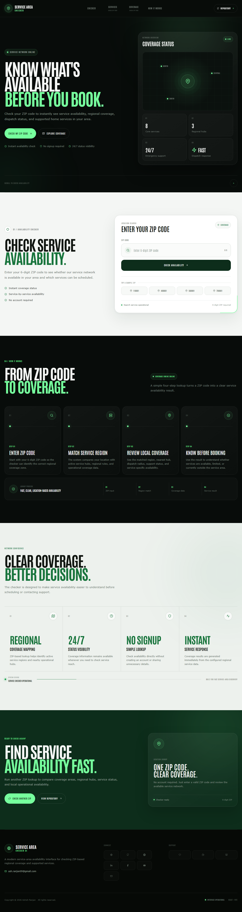

# Service Area Checker UI

A responsive React demo for checking Indian PIN-code service coverage. It uses a small, hard-coded sample dataset for Bengaluru; it is not connected to a real service provider or live availability system.

## Features

- Six-digit Indian PIN-code lookup with full, partial, and no-match states
- Sample regional hub, response, coverage, and service details
- Active section navigation with responsive mobile menu
- Fixed header, icon-only footer links, and go-to-top control

All displayed regions, hubs, response times, and service statuses are illustrative demo data. Do not use them to plan or book a real service.

## Tech stack

React, Vite, JavaScript, styled-components, and react-icons.

## Run locally

```bash
npm install
npm run dev
```

Build with `npm run build` and deploy with `npm run deploy`.

## Demo

[Open Service Area Checker UI](https://a2rp.github.io/service-area-checker-ui/)



## Links

- [Portfolio](https://www.ashishranjan.net/)
- [GitHub](https://github.com/a2rp)
- [CodePen](https://codepen.io/ash1198)
- [LinkedIn](https://www.linkedin.com/in/aashishranjan)
- [Facebook](https://www.facebook.com/theash.ashish/)
- [YouTube](https://www.youtube.com/@ashishranjan-ashz?sub_confirmation=1)
- [Email](mailto:ash.ranjan09@gmail.com)

## Support

- [Support](https://a2rp-donation-page.netlify.app/)
- [Buy Me a Coffee](https://buymeacoffee.com/a2rp)
- [Patreon](https://patreon.com/a2rp)
